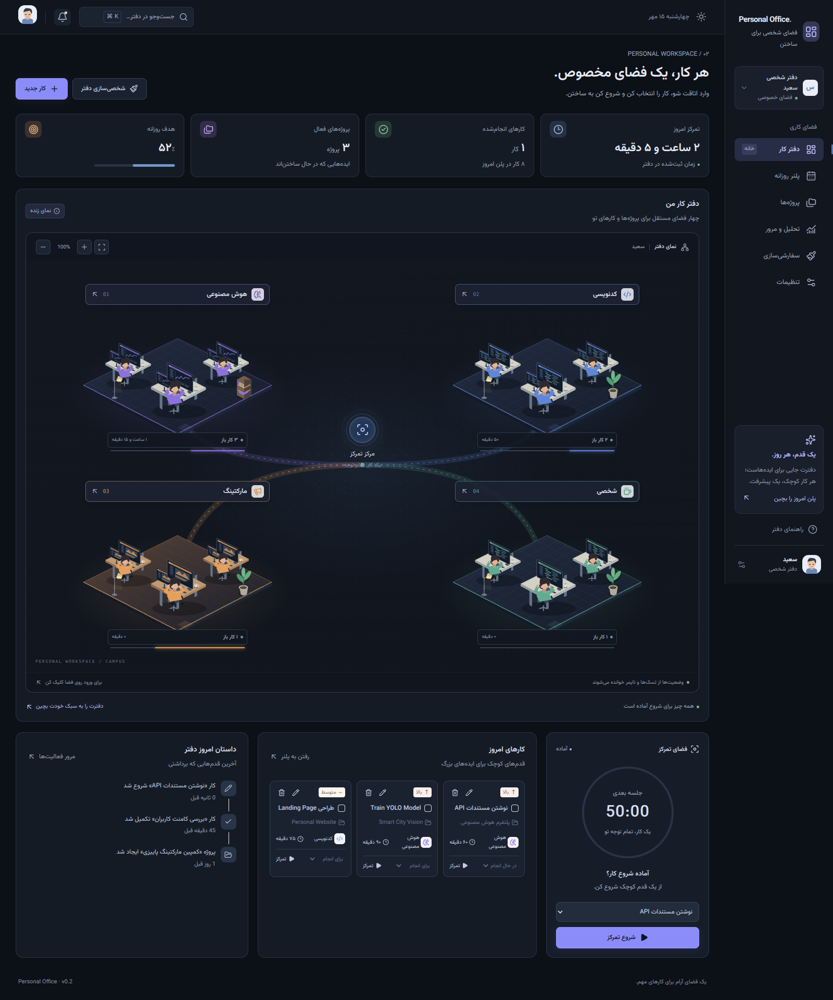
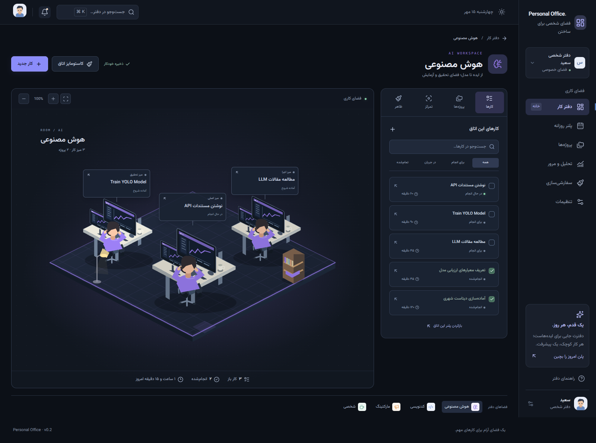
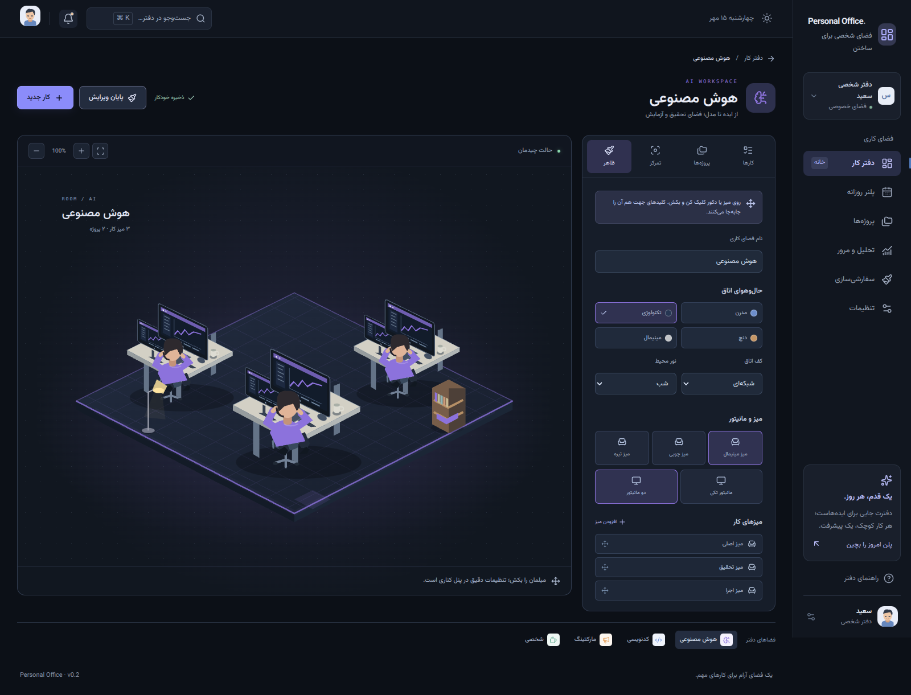
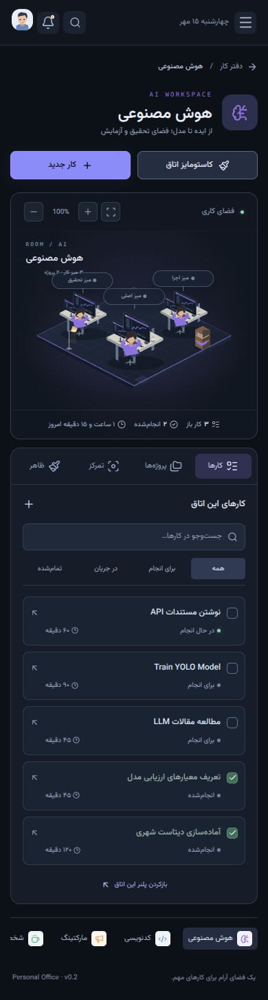

# بررسی نسخه 0.2

## GitHub Pages و نسخه‌بندی — ۲۰۲۶/۱۰/۰۸

- static build با prefix `/personal-office` موفق بود؛ CSS، JavaScript، فونت و SVGها بدون درخواست ناموفق لود شدند.
- خروجی واقعی `out/` در یک static server با 404 واقعی بررسی شد؛ سرور Next یا fallback مصنوعی SPA در این تست استفاده نشد.
- مسیر اصلی به دفتر منتقل شد؛ چهار اتاق و مسیرهای اصلی برنامه مستقیماً باز شدند.
- پروژهٔ تازه با UUID بعد از build ساخته شد؛ جزئیات آن از مسیر query باز شد و بعد از Refresh با status 200 باقی ماند.
- ساخت تسک در اتاق و حفظ آن بعد از Refresh بررسی شد.
- تب ظاهر از `?tab=customize` و تب تمرکز از `?tab=focus` باز شدند؛ نام اتاق بعد از Refresh حفظ شد.
- لینک‌های قبلی پروژه‌های نمونه و تصاویر واقعی مبلمان نیز بررسی شدند.
- دفتر، کاستومایزر اتاق و جزئیات پروژهٔ تازه در عرض ۳۹۰ و ۷۶۸ بدون overflow سند بودند.
- ۱۱ جریان بررسی مرورگر موفق بود؛ runtime error یا درخواست ناموفق استایل، اسکریپت، فونت و تصویر مشاهده نشد.
- دستورهای `version:patch`، `version:minor` و `version:major` در repository آزمایشی اجرا شدند: شمارهٔ package، commit و Tag دارای توضیح با هم تطبیق داشتند و working tree تمیز ماند.
- فایل‌های workflow به‌عنوان YAML معتبر بررسی شدند. اجرای واقعی GitHub Actions و انتشار دامنه پس از اولین push و فعال‌کردن Pages انجام می‌شود.

تاریخ: ۲۰۲۶/۱۰/۰۷. محیط بررسی: Node 24.19، Next.js 16.3.8 و Chromium 153 با Playwright. بررسی رابط کاربری با Production Build انجام شد.

## بررسی‌های خودکار

| فرمان               | نتیجه                                    |
| ------------------- | ---------------------------------------- |
| `pnpm lint`         | موفق، بدون هشدار                         |
| `pnpm typecheck`    | موفق، TypeScript strict                  |
| `pnpm test`         | ۱۶ تست در ۴ فایل، همه موفق               |
| `pnpm format:check` | موفق                                     |
| `pnpm build`        | موفق؛ شامل مسیر مستقل `/office/[roomId]` |

## تعامل‌های بررسی‌شده در مرورگر

- کلیک اتاق از نمای کلی، صفحه مستقل همان فضا را باز کرد.
- کلیک میز و برچسب آن، جزئیات تسک واقعی را در پنل اتاق باز کرد.
- تسک داخل اتاق هوش مصنوعی ساخته شد؛ حوزه قفل بود و فقط پروژه‌های همان حوزه قابل انتخاب بودند.
- تسک جدید بعد از Refresh باقی ماند؛ ویرایش، تکمیل، بازکردن و حذف همان شناسه نیز بررسی شد.
- Drag واقعی با pointer مختصات میز را تغییر داد؛ افزودن و حذف دکور عمل کرد.
- نام، تم، کف، نور، مدل میز، مانیتور و اتصال تسک به میز تغییر کردند و بعد از Refresh حفظ شدند.
- تنظیمات یک اتاق، JSON اتاق دیگر را تغییر نداد.
- شروع تمرکز، Refresh جلسه فعال، مکث، Refresh جلسه مکث‌شده، ادامه و پایان جلسه بررسی شدند؛ scene با جلسه هماهنگ شد.
- بازنشانی ظاهر اتاق تسک آزمایشی را حذف نکرد.
- حذف تسک، جلسه تمرکز ثبت‌شده قبلی را حفظ کرد.
- مسیرهای پلنر، پروژه‌ها، تحلیل، تنظیمات و اتاق نامعتبر باز و بررسی شدند.
- در جریان کامل بالا، خطای pageerror یا console error برنامه مشاهده نشد.

## نمایشگرها

نمای کلی دفتر، فضای مستقل اتاق و سفارشی‌سازی در عرض‌های ۳۹۰، ۷۶۸ و ۱۳۶۶ بررسی شدند. `scrollWidth` و `clientWidth` سند برابر بودند. canvas کلی دفتر در موبایل اسکرول داخلی دارد؛ داخل اتاق، ابزارها زیر صحنه قرار می‌گیرند. برچسب‌های کوچک میز روی موبایل فقط نام میز را نشان می‌دهند و عنوان کامل تسک در پنل خوانده می‌شود.

منوی موبایل باز و بسته شد و فرم تسک داخل viewport قرار گرفت. Escape فرم را بست. تصاویر دسکتاپ در ۱۶۰۰ × ۱۱۲۰ ثبت شدند.

## بررسی انتشار GitHub Pages — ۲۰۲۶/۱۰/۰۸

- خروجی `build:pages` برای `/personal-office` با ۱۹ صفحهٔ از پیش ساخته‌شده موفق بود؛ TypeScript، Lint، Format و هر ۱۶ تست نیز پاس شدند.
- Playwright روی فایل‌های واقعی `out` و سرور `preview:pages` اجرا شد؛ هیچ Next Server یا fallback مصنوعی برای مسیرها استفاده نشد.
- مسیر ریشه به دفتر منتقل شد؛ چهار اتاق و تمام صفحات اصلی با CSS، JavaScript، فونت و SVG درست باز شدند.
- ورود به اتاق و Refresh، تب سفارشی‌سازی با query، تغییر نام اتاق، ساخت تسک و ماندگاری هر دو پس از Refresh بررسی شدند.
- پروژهٔ جدید با UI ساخته شد؛ لینک آن از `/projects/detail/?projectId=…` باز شد و Refresh مستقیم HTML با status 200 و حفظ همان پروژه انجام شد.
- در عرض‌های ۳۹۰ و ۷۶۸، دفتر، کاستومایزر و جزئیات پروژهٔ تازه overflow در سند نداشتند.
- خطای runtime مرورگر یا درخواست ناموفق برای CSS، JavaScript، فونت و تصویر مشاهده نشد. مسیر ناموجود status 404 واقعی داشت.
- شمارهٔ فوتر و `version.json` برابر `package.json` بودند؛ `.nojekyll` نیز در خروجی وجود داشت.
- `version:patch` و `publish:github` در یک Git repository و remote محلی جداگانه تست شدند: افزایش `0.2.0` به `0.2.1`، Commit، Annotated Tag و Push کردن main و Tag موفق بود. نسخهٔ سورس اصلی `0.2.0` باقی ماند.
- اجرای واقعی GitHub Actions و انتشار آنلاین بعد از ساخت مخزن و Push کاربر انجام می‌شود؛ تنظیمات و دستورات دقیق در `GITHUB.md` هستند.

## محدودیت‌های فعلی

- این نسخه فرانت‌اند با ذخیره محلی است؛ Agent واقعی، Backend، auth، integration یا sync ابری اضافه نشده‌اند.
- محیط ایزومتریک SVG است؛ دوربین و مدل سه‌بعدی WebGL ندارد.
- زاویه، اندازه و جای میزها و دکور قابل تغییر است؛ Drag محدود به کف اتاق است.
- بررسی مرورگر روی Chromium انجام شده؛ Safari/Firefox و ممیزی کامل WCAG انجام نشده‌اند.
- اطلاعات origin قبلی با همان hostname/پورت در دسترس‌اند؛ ZIP داده مرورگر را منتقل نمی‌کند.

